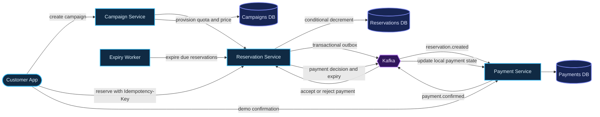
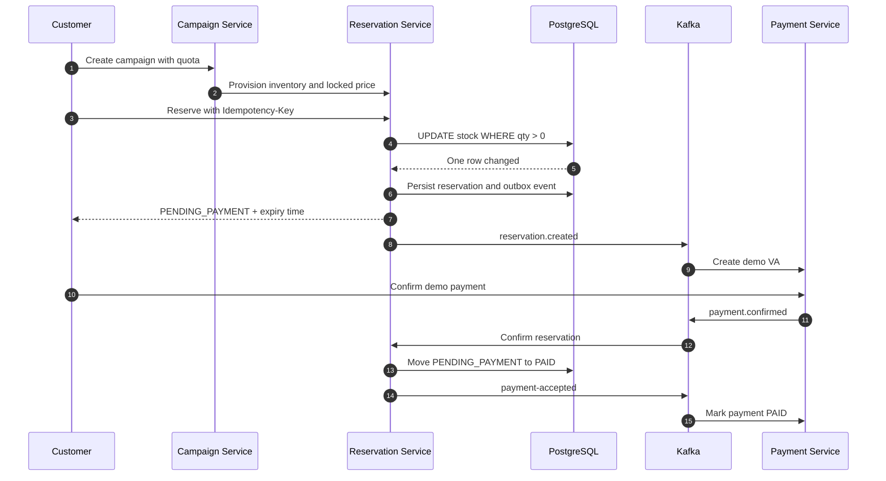

# Zero Oversell Commerce

> Flash-sale microservices in Java 21 and Spring Boot that protect inventory from overselling under concurrent checkout traffic.

[](https://openjdk.org/projects/jdk/21/)
[](https://spring.io/projects/spring-boot)
[](https://www.postgresql.org/)
[](https://kafka.apache.org/)

Zero Oversell Commerce is a portfolio implementation of a high-contention flash-sale checkout path. Campaign, reservation, payment, and expiry services run together locally; the payment provider is intentionally simulated.

## See traffic move through the system

Open the [interactive traffic simulator](https://yaumulmajid.github.io/zero-oversell-commerce/) to change quota, burst volume, and retry rate. It shows why a conditional PostgreSQL update accepts only the available inventory, even when demand exceeds stock. The source lives in [docs/architecture/traffic-simulator.html](docs/architecture/traffic-simulator.html).

## Technology stack

- Java 21
- Spring Boot 3.5.x
- PostgreSQL as the source of truth for inventory and reservations
- Redis included in the local stack for the planned admission-control layer
- Apache Kafka for asynchronous payment and expiry workflows
- Flyway for schema migrations
- Docker Compose for local infrastructure
- Spring Actuator and Micrometer for health and metrics

## Repository structure

```text
zero-oversell-commerce/
├── services/
│   ├── campaign-service/
│   ├── reservation-service/
│   ├── payment-service/
│   └── expiry-worker/
├── deploy/
│   ├── compose.yaml
│   └── observability/
├── docs/
│   ├── architecture/
│   ├── api/
│   └── decisions/
└── README.md
```

The reservation service uses feature-oriented Java packages:

```text
com.zerooversell.reservation/
├── conf/
├── constants/
├── controller/
├── dto/
├── entity/
├── repository/
├── service/
└── utils/
```

Java reserves `const` as a keyword, so the valid Java package name is `constants`.

## Architecture at a glance





### Service responsibilities

| Service | Responsibility | Data ownership |
|---|---|---|
| Campaign Service | Campaign metadata and initial quota; provisions stock and locked price | Campaign database |
| Reservation Service | Idempotent reservation API and atomic inventory reservation | PostgreSQL inventory, reservations, and outbox |
| Payment Service | Consumes reservation event, creates demo VA, and emits payment confirmation | Payment database and outbox |
| Expiry Worker | Polls Reservation Service to expire due reservations and release inventory | No direct cross-service table access |

Each stateful service owns a separate PostgreSQL database. Other services communicate through HTTP or Kafka events rather than querying another service's tables.

### Why it does not oversell

1. Campaign Service provisions a fixed quota and locked price in Reservation Service.
2. Reservation Service receives checkout requests with an `Idempotency-Key`.
3. It runs this PostgreSQL operation inside the same transaction that creates the reservation and outbox event:

   ```sql
   UPDATE flash_stock
   SET qty = qty - 1
   WHERE sale_id = :sale_id AND qty > 0;
   ```

4. Exactly one updated row reserves a unit. No updated row means sold out. The database constraint also prevents negative inventory.
5. The outbox sends `reservation.created` to Kafka. Payment Service creates a demo VA record using the locked amount, currency, and expiry.
6. Payment confirmation returns by Kafka. Reservation Service owns the final state decision, protecting the payment-versus-expiry race.
7. Expiry Worker calls Reservation Service for due items. Only a successful `PENDING_PAYMENT → EXPIRED` transition releases a unit.

### Consistency and failure handling

- PostgreSQL is the inventory source of truth. `CHECK (qty >= 0)` is a second guard behind the conditional update.
- A unique `(sale_id, customer_id)` constraint enforces one reservation per customer per campaign.
- Idempotency keys prevent ordinary client retries from creating duplicate reservations.
- The transactional outbox prevents a committed reservation from losing its event if Kafka is temporarily unavailable.
- Kafka consumers are idempotent because messages may be delivered more than once.
- Payment and expiry transitions use conditional state changes so only one transition can claim the reservation.
- Redis is provisioned by Compose but is not wired into the current request path yet. PostgreSQL remains the sole stock authority in this implementation.

More detail is in [the architecture design](docs/architecture/high-level-design.md), [the API contract](docs/api/reservations.md), and [the design decisions](docs/decisions/0001-postgresql-is-inventory-authority.md).

## Run locally

Build and start PostgreSQL, Redis, Kafka, and all four applications:

```bash
docker compose -f deploy/compose.yaml up --build -d
```

Build all four Java services with the root Maven reactor: `mvn -B -DskipTests package`.

Create a campaign (this provisions its stock in Reservation Service):

```bash
curl -X POST http://localhost:8080/api/v1/campaigns \
  -H 'Content-Type: application/json' \
  -d '{"name":"Live Flash Sale","unitPrice":125000,"currency":"IDR","quantity":100}'
```

Use the returned `campaignId` to reserve one unit:

```http
POST http://localhost:8081/api/v1/reservations
Idempotency-Key: checkout-001
Content-Type: application/json

{
  "saleId": "<campaignId from previous response>",
  "customerId": "00000000-0000-0000-0000-000000000201"
}
```

The reservation response contains `reservationId`. After the Kafka consumer creates the payment, inspect it with `GET http://localhost:8082/api/v1/payments/{reservationId}`. For this local demo only, confirm payment with `POST http://localhost:8082/api/v1/payments/{reservationId}/demo-confirm`. Poll the reservation and payment lookups until both show `PAID`. To exercise expiry, create a fresh campaign/reservation and let the configured reservation TTL elapse; the expiry worker polls every five seconds.

Health endpoints: `http://localhost:8080/actuator/health`, `8081/actuator/health`, `8082/actuator/health`, and `8083/actuator/health`.

## Validation scenario

The portfolio load-test target is 250,000 concurrent attempts for 100 units. Acceptance criteria: no more than 100 reservations succeed, inventory never becomes negative, retries do not create duplicate orders, and expiry returns each reserved unit at most once. These are target criteria, not claimed benchmark results; measured results should be added after the load test is implemented and run.

## Current implementation scope

The local end-to-end flow includes campaign provisioning over HTTP, atomic reservation in PostgreSQL, a transactional outbox to Kafka, demo payment intent creation, payment confirmation back through Kafka, and scheduled expiry with stock release. Redis admission control, a real payment provider, authentication between internal services, reconciliation automation, dashboards, and the 250,000-request load test remain follow-up work.
