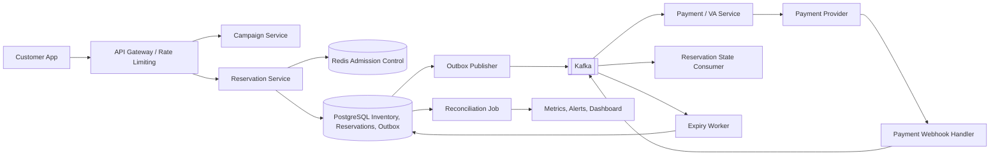

# Zero Oversell Commerce

**Zero Oversell Commerce** is a portfolio system design and implementation for flash-sale commerce. Its core goal is to ensure that simultaneous purchase requests never reserve more units than the campaign has available.

The repository is organized as independently deployable services. The first runnable implementation is the reservation service; the other service directories describe planned boundaries and will be implemented as the portfolio grows.

## Technology stack

- Java 21
- Spring Boot 3.5.x
- PostgreSQL as the source of truth for inventory and reservations
- Redis for admission control and fast quota screening
- Apache Kafka for asynchronous payment and expiry workflows
- Flyway for schema migrations
- Docker Compose for local infrastructure
- Spring Actuator and Micrometer for health and metrics

## Repository structure

```text
zero-oversell-commerce/
├── services/
│   ├── campaign-service/
│   ├── reservation-service/
│   ├── payment-service/
│   └── expiry-worker/
├── deploy/
│   ├── compose.yaml
│   └── observability/
├── docs/
│   ├── architecture/
│   ├── api/
│   └── decisions/
└── README.md
```

The reservation service uses feature-oriented Java packages:

```text
com.zerooversell.reservation/
├── conf/
├── constants/
├── controller/
├── dto/
├── entity/
├── repository/
├── service/
└── utils/
```

Java reserves `const` as a keyword, so the valid Java package name is `constants`.

## Architecture



### Service responsibilities

| Service | Responsibility | Data ownership |
|---|---|---|
| Campaign Service | Campaign schedule, product, price, and initial quota | Campaign database |
| Reservation Service | Idempotent reservation API and atomic inventory reservation | PostgreSQL inventory, reservations, and outbox |
| Payment Service | Payment intent / VA creation and provider callback verification | Payment database |
| Expiry Worker | Expire unpaid reservations and release inventory exactly once | Reservation API/events; no direct cross-service table access |
| Reconciliation Job | Compare inventory, reservations, and payment outcomes; emit alerts | Read-only service APIs or exported events |

Each service owns its data. Other services communicate through APIs or Kafka events rather than querying another service's tables.

### Purchase flow

1. The client sends a reservation request with an `Idempotency-Key`.
2. The gateway authenticates the caller and applies rate limits.
3. Redis may provide a fast admission check, but it does not authorize the final sale.
4. Reservation Service starts a PostgreSQL transaction and executes a conditional stock decrement:

   ```sql
   UPDATE flash_stock
   SET qty = qty - 1
   WHERE sale_id = :sale_id AND qty > 0;
   ```

5. One affected row means the unit was reserved. Zero rows means stock is unavailable. The reservation row and an outbox event commit in the same transaction.
6. The outbox publisher sends `ReservationCreated` to Kafka. Payment Service creates a short-lived VA and records its provider reference.
7. The payment provider calls the webhook endpoint. The callback is verified and deduplicated before a payment event is published.
8. A state consumer moves the reservation to `PAID`. If its TTL expires first, Expiry Worker conditionally moves it from `PENDING_PAYMENT` to `EXPIRED` and releases one unit.
9. Reconciliation checks for mismatches and pages the operator when a campaign invariant is violated.

### Consistency and failure handling

- PostgreSQL is the inventory source of truth. `CHECK (qty >= 0)` is a second guard behind the conditional update.
- A unique `(sale_id, customer_id)` constraint enforces one reservation per customer per campaign.
- Idempotency keys prevent ordinary client retries from creating duplicate reservations.
- The transactional outbox prevents a committed reservation from losing its event if Kafka is temporarily unavailable.
- Kafka consumers are idempotent because messages may be delivered more than once.
- Payment and expiry transitions use conditional state changes so only one transition can claim the reservation.
- Redis is an optimization. If it is unavailable, admission can degrade to gateway throttling and database protection, subject to database capacity.

More detail is in [the architecture design](docs/architecture/high-level-design.md), [the API contract](docs/api/reservations.md), and [the design decisions](docs/decisions/0001-postgresql-is-inventory-authority.md).

## Run locally

Start PostgreSQL, Redis, and Kafka:

```bash
docker compose -f deploy/compose.yaml up -d
```

Run the reservation API:

```bash
cd services/reservation-service
mvn spring-boot:run
```

Create a reservation:

```http
POST http://localhost:8081/api/v1/reservations
Idempotency-Key: checkout-001
Content-Type: application/json

{
  "saleId": "00000000-0000-0000-0000-000000000100",
  "customerId": "00000000-0000-0000-0000-000000000201"
}
```

The local migration seeds a demo campaign with 100 units. Health endpoint: `GET http://localhost:8081/actuator/health`.

## Validation scenario

The portfolio load-test target is 250,000 concurrent attempts for 100 units. Acceptance criteria: no more than 100 reservations succeed, inventory never becomes negative, retries do not create duplicate orders, and expiry returns each reserved unit at most once. These are target criteria, not claimed benchmark results; measured results should be added after the load test is implemented and run.

## Current implementation scope

The reservation API and PostgreSQL migration are the initial vertical slice. Redis admission, Kafka outbox publishing, payment integration, expiry processing, reconciliation, dashboards, and load testing are architecture targets and are not yet wired into the application.
