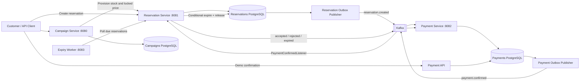

# High Level System Design

## Goal and invariants

The system handles limited-quantity flash-sale campaigns. Accepted reservations must never exceed inventory, including during concurrent requests. A pending reservation holds one unit until payment is confirmed or its TTL expires.

## Connected local architecture



Each stateful service has its own database. The compose stack uses one PostgreSQL container with three databases. Kafka carries reservation and payment events. Campaign inventory provisioning and expiry coordination use internal HTTP APIs.

## Service responsibilities

### Campaign Service

`POST /api/v1/campaigns` stores campaign metadata and synchronously calls Reservation Service to provision the campaign's quantity, locked unit price, and currency. It stores campaign data only after provisioning succeeds. `GET /api/v1/campaigns/{id}` returns campaign details.

### Reservation Service

Owns inventory, reservation state, and the transactional outbox. It exposes reservation creation and lookup APIs, plus internal provisioning and expiry commands. The stock decrement, reservation row, and `reservation.created` outbox event are committed in one database transaction.

### Payment Service

Consumes `reservation.created`, persists one demo payment intent per reservation, and returns a demo VA reference. `POST /api/v1/payments/{reservationId}/demo-confirm` simulates a provider confirmation request. It commits `CONFIRMATION_PENDING` and a `payment.confirmed` outbox event together. Payment Service only marks its payment `PAID` after Reservation Service emits `reservation.payment-accepted`; rejection and expiry events update its local status. A real provider adapter and signature verification are not included.

### Expiry Worker

Polls Reservation Service on a fixed interval. Reservation Service locks due pending rows, changes each to `EXPIRED`, and releases its unit in the same database transaction. Worker retries on the next poll after connection failures.

## End-to-end flow

1. Create a campaign. Campaign Service provisions stock and price in Reservation Service over HTTP, then stores campaign metadata.
2. Submit a reservation with `Idempotency-Key`. Reservation Service decrements stock conditionally, stores the pending reservation, and writes an outbox event atomically.
3. The reservation outbox publisher sends `reservation.created` to Kafka. Payment Service creates a demo VA with the same amount, currency, and expiry.
4. Poll `GET /api/v1/payments/{reservationId}` until the asynchronous payment record is available.
5. Confirm the demo payment. Payment Service stores `CONFIRMATION_PENDING` plus `payment.confirmed` in its transaction and publishes the event from its outbox.
6. Reservation Service locks the reservation and checks its deadline. It either moves the reservation from `PENDING_PAYMENT` to `PAID` or expires it and releases inventory, then emits an accepted or rejected decision for Payment Service.
7. If no payment is requested before TTL, Expiry Worker invokes the due-reservation command. Only successful transition from `PENDING_PAYMENT` to `EXPIRED` returns stock; Payment Service receives the expiry event and marks a pending payment expired.

## Inventory correctness

The authoritative SQL operation is:

```sql
UPDATE flash_stock
SET qty = qty - 1
WHERE sale_id = :sale_id AND qty > 0;
```

One updated row grants a unit; zero rows means no available stock. The decrement and reservation insert share one PostgreSQL transaction, so either both commit or both roll back. `CHECK (qty >= 0)` and unique `(sale_id, customer_id)` constraints provide additional guards. Redis is present in Compose but is not yet used in the request path; PostgreSQL remains the only stock authority.

The outbox publisher gives at-least-once delivery: a crash after Kafka accepts an event but before the database marks it published may emit a duplicate. Consumers must remain idempotent. Payment creation uses a unique reservation ID; reservation state updates are conditional.

## Failure behavior and current boundaries

| Failure | Behavior |
|---|---|
| PostgreSQL unavailable | API fails closed; no reservation or payment instructions are issued. |
| Kafka unavailable | Outbox events remain pending and retry after broker recovery. |
| Campaign provisioning request fails | Campaign is not stored as active; caller receives an error and may retry. |
| Duplicate payment event | Existing payment record is reused. |
| Payment and expiry race | Reservation's conditional state transition allows only one to win; a late payment confirmation is ignored if the reservation has expired. |
| Expiry worker unavailable | Pending reservations remain reserved until the worker resumes; poll resumes on recovery. |

This is a connected local portfolio flow, not a production-ready payment or security implementation. The demo callback only simulates a provider notification and does not move actual funds. Internal endpoints are unauthenticated in the local demo. Redis admission control, API gateway, signed provider callbacks, reconciliation automation, and dashboards remain future work.

## Portfolio load scenario

Target a test of 250,000 concurrent attempts for 100 units. Acceptance criteria: at most 100 reservations, non-negative inventory, stable idempotency on retries, and each expired reservation returns stock once. Publish measured throughput and latency only after running and recording the load test.
