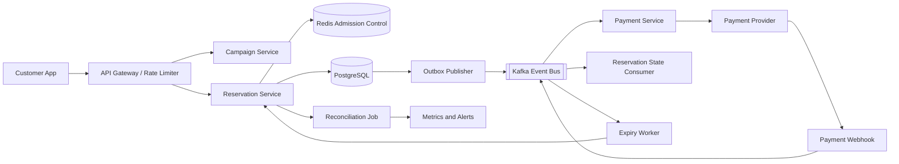
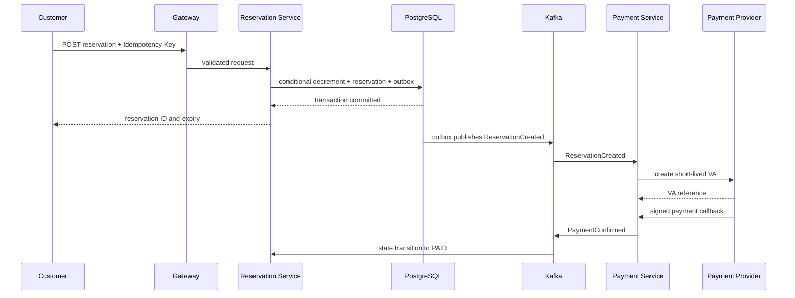

# High Level System Design

## Context and goals

The system handles limited-quantity live-commerce campaigns. The central correctness rule is that accepted reservations must never exceed campaign inventory, even when requests arrive concurrently. Reservations expire if payment is not completed within a short time window.

## System context



## Service boundaries

### Campaign Service

Owns campaign metadata, schedule, product price, and starting quota. It publishes campaign activation and closure events. It does not decrement live inventory for each customer.

### Reservation Service

Owns inventory availability, reservation records, idempotency, and the outbox. Its PostgreSQL transaction conditionally decrements one unit and creates the reservation. It exposes reservation APIs and internal commands for payment/expiry transitions.

### Payment Service

Owns payment intent and provider references. It creates a VA only for an accepted reservation, verifies callback signatures and provider status, and emits deduplicated payment events.

### Expiry Worker

Consumes scheduled expiry events or scans due reservations. It asks Reservation Service to expire a pending reservation; it never writes the reservation database directly. The service returns inventory only when the pending-to-expired transition succeeds.

### Reconciliation

Compares inventory counts against pending and paid reservations, and checks payment provider outcomes. It alerts operators on mismatches. Automated correction should be audited and idempotent.

## Reservation sequence



## Inventory consistency

The authoritative operation is a single conditional update:

```sql
UPDATE flash_stock
SET qty = qty - 1
WHERE sale_id = :sale_id AND qty > 0;
```

One updated row grants a reservation; zero rows means no inventory is available. The decrement and reservation insert share one PostgreSQL transaction, so either both commit or both roll back. A `CHECK (qty >= 0)` constraint provides a second guard. Redis can shed load before PostgreSQL but cannot authorize a sale by itself.

The outbox row is committed with the reservation, then asynchronously relayed to Kafka. Event consumers expect duplicate delivery and store processed event IDs or use conditional state changes. Do not hold a database transaction open while calling the payment provider.

## Failure behavior

| Failure | Behavior |
|---|---|
| Redis unavailable | Apply gateway throttling and rely on PostgreSQL conditional update, within database capacity. |
| PostgreSQL unavailable | Fail closed; do not issue payment instructions. |
| Kafka unavailable | Persist outbox rows and retry publishing after recovery. |
| VA creation fails | Retry transient errors; cancel and release stock on terminal failure. |
| Duplicate/late callback | Verify provider state and deduplicate; never revive an expired reservation implicitly. |
| Expiry races payment | Use conditional status transition so only one operation wins. |
| Worker repeats | Idempotent status transition ensures inventory release happens once. |

## Scalability and operations

Scale stateless API instances horizontally. Use gateway rate limits, bounded DB connection pools, Kafka consumer groups, and partition event streams by reservation or campaign ID where ordering is needed. Monitor reservation acceptance/decline counts, database update latency, remaining quota, oldest outbox age, Kafka lag, pending reservation age, webhook errors, and reconciliation drift.

## Portfolio load scenario

Use 250,000 concurrent attempts for a campaign with 100 units as a target load test. Verify at most 100 pending reservations, non-negative inventory, idempotent retries, and exactly-once effective expiry. These are acceptance criteria; publish measured throughput and latency only after running the test.
